# Product capability map

This map defines how the feature areas depend on each other. It is not a release plan. Each feature spec owns its area. The [docs index](../README.md#feature-specifications-docsfeatures) routes to it.

## Phases

- **Phase 1** builds the operational core: customers, work, people, time, planning, documents, material, service and the commercial loop as one system. Phase 1 is complete when work crosses feature boundaries without anyone retyping customer, job, time, document, material or price data.
- **Phase 2** adds AI assistance and automation on the records, permissions, events and review paths of Phase 1. It never covers a workflow that Phase 1 left incomplete.
- A phase label states a dependency, not a date.

## The operating loop

Every step enriches the same records and prepares the next step. A feature that works only on its own screen is not complete.

```mermaid
flowchart LR
    A["Customer request"] --> B["Customer, site, and equipment context"]
    B --> C["Offer, scope, or service decision"]
    C --> D["Job or project"]
    D --> E["Schedule people and resources"]
    E --> F["Prepare documents and material"]
    F --> G["Execute in the field"]
    G --> H["Capture time, material, photos, measurements, and approval"]
    H --> I["Complete, report, and hand over"]
    I --> J["Invoice, payment, and accounting handoff"]
    J --> K["Post-calculation, reporting, and follow-up"]
    K --> A
```

Recurring service adds a second loop: installed equipment, maintenance obligation, planned visit, field evidence, equipment history, next due work.

## Shared foundations

Build each foundation once and reuse it in every feature:

- the organization boundary and the three roles;
- activity and audit history;
- one attention list for tasks, approvals and exceptions (`/aufgaben`);
- notifications that link to the exact context;
- search and navigation across related records;
- import, export and exit;
- templates and settings with SHK defaults.

## Concepts to keep apart

[data-model.md](../technical/data-model.md) owns the implemented domains. Keep these distinctions when a feature adds a domain:

- A job is the work. An appointment is planned time for it.
- An assignment is responsibility. A time record is what happened.
- A catalog item is a definition. Stock is physical availability. Planned, reserved and consumed material are separate states.
- An uploaded invoice file is a document. A payment or an accounting event is a financial fact.
- A site is the place of work. A customer may have several.
- Installed equipment belongs to the customer and carries service history. A tool belongs to the business.
- An automation run records its trigger, its decision, the action it proposed or performed, the approval, the result and the cost.

## Handoff rules

Every feature follows these rules:

1. Link to an existing customer, job, employee, document, item or invoice. Do not copy it.
2. Planned, approved, ordered, received, consumed, completed, invoiced and paid are different states with different owners.
3. A change in one feature never silently changes another. A calendar move does not rewrite time, message a customer, move stock or create an invoice.
4. An action that creates a legal, financial, customer, scheduling or supplier commitment shows a preview and needs approval.
5. A correction keeps the historical record.
6. Field workers get only what their assigned work needs. Office users keep the connected overview.
7. A sync, integration, message, payment, document-processing or automation failure has an owner and a recovery path.
8. Generated reports, extracted invoices and proposed orders stay drafts until the responsible user accepts them.

## Phase 2 levels

Phase 2 advances one level at a time:

1. **Assist.** Search, summarize, extract, classify and draft.
2. **Recommend.** Name anomalies, risks, next actions and options, with evidence.
3. **Automate templates.** Run product-owned triggers and actions with defined approvals.
4. **Compose workflows.** Let authorized users combine safe triggers, conditions, approvals and actions.
5. **Delegate to bounded agents.** Allow multi-step work within explicit data, tool, cost and approval limits.

## Decision gates

A gate needs an owner decision before work starts. A competitor offering the capability is no reason to build it.

| Gate | Boundary |
| --- | --- |
| Native accounting | Build accounting-ready records and exports. No double-entry bookkeeping, tax logic or statutory reporting. |
| Native payroll | Prepare and export payroll data. No wage calculation. |
| Generic CRM | Customer, contact, site, request and communication history only. No campaigns, pipelines or lead scoring. |
| Customer portal | Scope it by the external interactions that justify its identity, permission, support and notification cost. |
| External calendars | Export is the simple case. Two-way Google or Microsoft sync needs source ownership, private events, duplicates, conflict recovery and offboarding rules. |
| Open automation platform | Product-owned templates come before a workflow builder. |
| IoT monitoring | Equipment history and maintenance only. No telemetry or device control. |

## When behavior changes

- Update the feature spec's **Current Product Baseline** in the same change.
- Update [data-model.md](../technical/data-model.md) when a domain boundary changes.
- Update this map when a change affects a phase, a shared foundation, a handoff rule or a gate.
